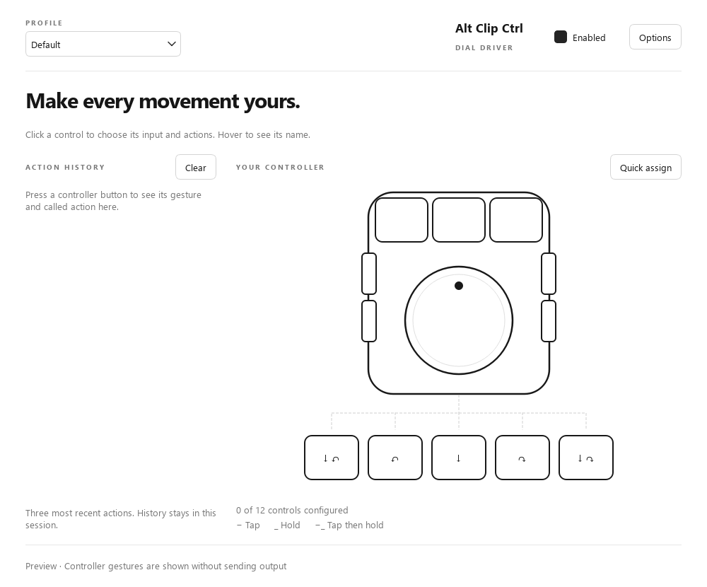

# Alt Clip Ctrl

Alt Clip Ctrl 2.2 maps a programmable dial and its buttons to keyboard shortcuts, scrolling, tool cycles and application profiles. The new app was previously called Inbetween.



## Use the app

On Windows, extract the complete `AltClipCtrl-Windows.zip` and open `AltClipCtrl/AltClipCtrl.exe`. Keep the `_internal` folder beside it. Close any older Alt Clip Ctrl or Inbetween copy first.

Give each controller signal its own key in the controller's configuration software, then use **Quick assign** to record the inputs. Click any outlined control to choose its actions. Input and output support **F1–F24**, and outputs support modifier chords.

- A clean controller map with user-defined names in hover tooltips.
- Tap (−), Hold (_) and Tap then hold (−_) actions.
- Held dial scrolling, dial cycling and temporary dial modifiers, with direction reversal.
- Inline dial modifier editing with the main page's five dial controls.
- Hold + dial: hold a key for panning, then release that output and switch to scrolling or another dial mode on the first turn.
- Multiple named cycle lists per profile, selectable separately for each button or dial action.
- Shared shortcuts update matching lists in the current profile; other lists keep their last confirmed position.
- A profile dropdown, program-linked profiles and button actions that switch profiles.
- The three most recent actions, with input lighting and the actual called action.
- Optional scroll acceleration with an adjustable **1×–10×** factor in **Options → Advanced**.

Existing Inbetween JSON settings are copied automatically on first launch. The original file stays intact, and existing Alt Clip Ctrl JSON settings take priority. The previous modifier-based Windows helper's XML settings can be imported from Options.

See the [setup and usage guide](docs/AltClipCtrl.md) for default signals, gesture details and platform requirements.

## Platforms

| Platform | Input and output | Program-linked profiles |
| --- | --- | --- |
| Windows | Native keyboard listener and Windows keyboard/wheel output | Foreground executable and window |
| Linux | The selected evdev controller and uinput; device access is required | X11; select profiles manually on Wayland |
| macOS | Quartz event tap; Accessibility and Input Monitoring access are required | Foreground application |

The UI and gesture engine are shared. Windows has packaged startup and native delivery checks; Linux and macOS adapters still require hardware validation. This is a user-space input translator, not replacement device firmware.

## Run from source

Use Python 3.10–3.13 in a virtual environment:

```text
python -m pip install -r requirements-altclipctrl.txt
python -m altclipctrl
```

`python -m altclipctrl --preview` opens the interface without global input or output. `--settings PATH` selects a separate settings file. The old `python -m inbetween` launch command remains available for compatibility.

Build on the destination operating system:

```text
python build-altclipctrl.py
python package-altclipctrl.py
```

The build is written to `outputs/AltClipCtrl`. The Windows packaging command creates `outputs/AltClipCtrl-Windows.zip` and `outputs/AltClipCtrl-Source.zip`. Shared libraries, third-party notices and build instructions accompany the package; see [third-party components](docs/AltClipCtrl-Third-Party.md).

## Validation

```text
python -m unittest discover -s tests -p "test_*.py"
python -m tests.ui_smoke
```

Unit and offscreen UI tests cover gestures, profile management, dial modes, acceleration, input repeat handling, window changes, settings migration and cleanup. The opt-in Windows native tests use an isolated receiver that consumes their generated input. They measure native delivery, not physical notch-to-screen latency.

## Previous Windows helper

The original modifier-based helper is retained in `src/`, with `build.ps1` and `test.ps1`. Its [documentation](docs/Legacy-Windows.md) and [v1.4.1 release](https://github.com/SimplePhilipp/Alt-Clip-Ctrl/releases/tag/v1.4.1) remain available. Close it before using the new app.
