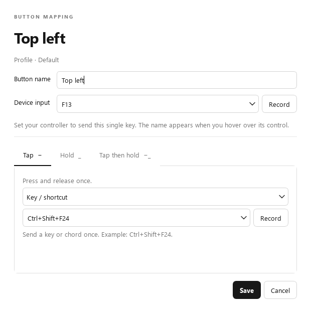
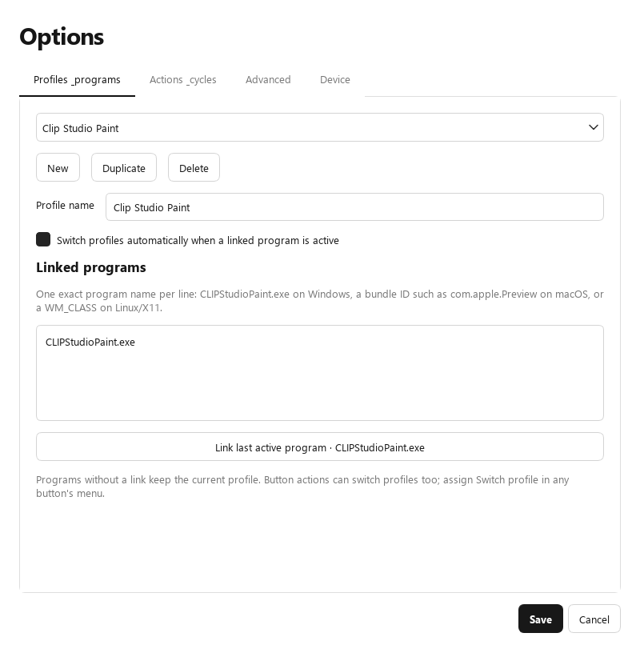
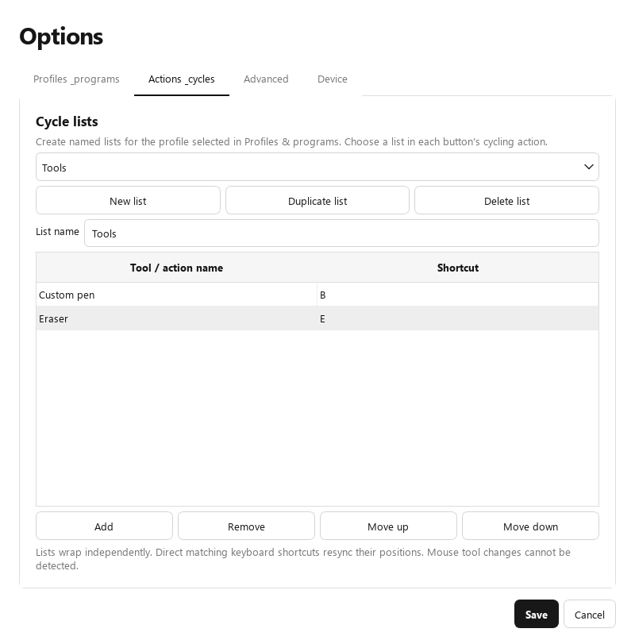
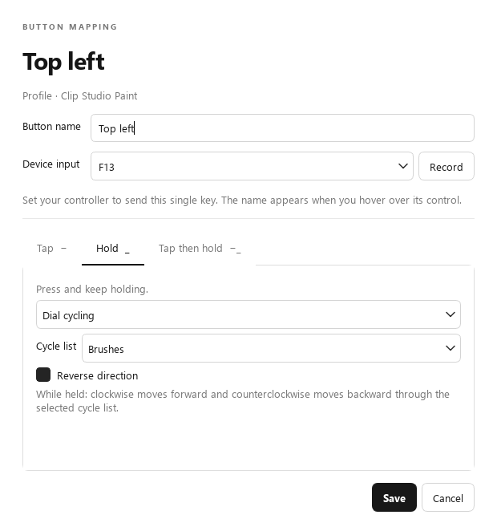

# Alt Clip Ctrl

A new companion app between a programmable dial and the application you use. This is a user-space input translator, not a kernel driver or replacement firmware. The interface and gesture engine are shared across Windows, Linux and macOS; each OS has its own native input adapter.

## Start on Windows

1. Close other copies of Alt Clip Ctrl, including older Inbetween builds. Exit the legacy Windows helper using its tray menu. Shared guards prevent the apps from interpreting the same signals together.
2. Extract the complete `AltClipCtrl-Windows.zip` folder, then open `AltClipCtrl/AltClipCtrl.exe`. Keep the `_internal` folder beside the executable.
3. In your controller's own configuration software, give each signal its own single key with press/release events, without modifiers. You can use the defaults below, or use **Quick assign** to record the keys the controller already sends.
4. Click a control in Alt Clip Ctrl to edit its name and output actions. Save the mapping, switch to your drawing app, and use the controller.

The controller configuration step is required. The app does not identify, flash, or reprogram a USB device. No output actions are assigned by default, so choose the actions you want first.

| Control | Default input |
| --- | --- |
| Top left / middle / right | F13 / F14 / F15 |
| Left upper / lower | F16 / F17 |
| Right upper / lower | F18 / F19 |
| Pressed counterclockwise | F20 |
| Counterclockwise | F21 |
| Pressed neutral | F22 |
| Clockwise | F23 |
| Pressed clockwise | F24 |

The last five controls appear below the dial in exactly that order. The circle represents the dial; its input editors are those five controls. The schematic has no text labels or button names. Names and assigned inputs appear in hover tooltips and in the action history.

## Quick assign and action history

Choose **Quick assign** to record the current profile's inputs. The program highlights one control at a time. Press and release an ordinary button once; press the dial once without turning for the neutral press. For each of the four turning signals, turn in the requested direction until three matching down/up pulses are received within two seconds. A single initial dial-press signal does not complete a turning assignment, and holding a key with auto-repeat does not count as repeated turns. When asked for a pressed turn, keep the dial pressed while turning it.

The highlighted control and recording progress remain visible on the main screen. Back revisits a control, Skip keeps its previous input, Cancel discards the recording, and **Save inputs** applies the complete draft after checking for duplicate inputs. Output actions are preserved. Quick assign learns the controller's keyboard signals; it does not change the device firmware. All normal output is paused during recording.

**Action history** is on the left and shows only the **three most recent actions**. Each entry shows the control name/input, recognised gesture, called action and profile, including the actual shortcut chosen by a cycle and effective scrolling direction. Buttons light up on input and remain lit while held. History is not saved to disk and can be cleared.

While the main Alt Clip Ctrl window has focus, controller input runs a **Preview** of the gesture/action. It lights the controls and adds clearly marked preview entries without sending keyboard or mouse output into the interface. Profile-switch actions still select the requested profile. When another app has focus, the normal output runs and history shows the called action. Opening a settings dialog suspends preview and normal actions.

## Button actions

The seven outer buttons and pressed-neutral signal support three independent gestures:

- **Tap (−):** press and release. The output waits for the second-press window so a double gesture does not also fire a tap.
- **Hold (_):** keep the button down. Its action starts after the hold threshold.
- **Tap then hold (−_):** tap, release, and press again within the second-press window. Its action starts on the second press.

**Tap (−)** offers No action, Key / shortcut, Cycle list next/previous, Scroll up/down and Switch profile. **Hold (_) and Tap then hold (−_)** offer No action, Hold a key, Dial scrolling, Dial cycling, Dial modifier and Switch profile. The held menus have no directional scroll/cycle actions or Key / shortcut.

- **Dial scrolling:** while the button is held, clockwise turns scroll up and counterclockwise turns scroll down. Pressed turns follow the same direction rule. Each assignment has its own **Reverse direction** checkbox. Global scroll amount and reversal in Options also apply.
- **Dial cycling:** choose a named cycle list for this action. While held, clockwise advances and counterclockwise goes backward through that list. Each assignment has its own **Reverse direction** checkbox, independent of the scrolling assignments. Different held buttons can use different lists, and each list remembers its own position.
- **Dial modifier:** choose **Configure temporary dial controls…** to assign temporary outputs for all five dial signals. The physical input keys stay the same. A dial press runs its temporary action once on release; turning while pressed cancels that press action. The chosen held button's release restores the normal dial outputs. No Alt/Ctrl/Shift input interpretation is involved.

These are temporary modes, not one-off actions fired when holding starts. A first dial movement can activate a held dial mode before the hold timer expires; Tap then hold activates its mode on the second press. If two mode buttons overlap, the most recently activated mode takes priority. Releasing it resumes the other still-held mode; releasing the final mode button restores the base mappings. Focus changes, profile switches, pause, settings changes and exit also clear temporary modes.

Hold a key can include pure Ctrl, Alt, Shift or Meta. Older saved shortcuts in held gestures migrate to Hold a key, keeping the chosen key/chord. Older directional scroll/cycle actions in held gestures migrate to the matching dial mode, using Reverse direction for down/previous. Ordinary modifier keys are outputs, never activation inputs. On macOS Meta means Command; on Windows it means the Windows key; on Linux it means Super.

Dial rotation signals run one action immediately on each down/up pulse. They have no tap/hold delay. Pressed turns cancel a pending neutral-button tap, preventing an extra click action when the dial is turned while pressed.

Output shortcuts accept keys such as `B`, `F24`, `Space`, `[`, `Minus`, `Plus`, and chords such as `Ctrl+Shift+F24`. The Record button captures a key or chord; keys can also be chosen or typed. Input signals must be unique single keys within a profile. Because this is a keyboard-signal translator, a normal keyboard key matching an assigned signal is also intercepted on Windows/macOS while the driver is enabled. Dedicated F13–F24 inputs reduce collisions.

## Profiles and Options

The profile selector is at the top left. **Options → Profiles & programs** creates, duplicates, renames and deletes profiles, and links a profile to exact executable names, macOS bundle IDs or Linux WM_CLASS names. Link last active program fills in the last observed external app. Foreground checks run every 250 ms. A program's linked profile activates when focus changes to it; a manual or button-driven profile change persists until the next app change. Unlinked apps keep the active profile.

Assign **Switch profile** in a button editor to select a destination profile for that gesture. A referenced profile cannot be deleted until its incoming button actions are changed.

**Actions & cycles** manages up to 64 named cycle lists for the profile selected in Profiles & programs. Select a list from the dropdown, change its **List name**, or use **New list**, **Duplicate list** and **Delete list**. Each list contains 1–64 named shortcuts, supports reordering and wraps independently. Pending edits are retained when switching lists or profiles; Save applies them and Cancel discards them. A list used by a button or temporary dial mapping cannot be deleted until that action selects another list. Keep at least one list per profile.

In a button's action editor, **Cycle list · next**, **Cycle list · previous**, and **Dial cycling** each show a **Cycle list** dropdown. This also works for next/previous outputs inside Dial modifier. Renaming a list keeps its button assignments. Each profile/list pair remembers its own position; switching profiles or held dial modes preserves that position. Matching direct keyboard shortcuts resynchronise every list containing that shortcut. Mouse tool selection cannot be detected.

Existing single-list settings automatically migrate to a list named **Default**, preserving entries and cycle actions. Settings use format version 2 starting with Alt Clip Ctrl 2.1. **Advanced** contains tap/second-press timing, hold timing, scroll amount (1–20), direction reversal, optional scroll acceleration, and a legacy Windows XML importer. Timing and scroll options apply globally.

**Scroll acceleration** is off by default, including for existing settings. Enable its checkbox in **Options → Advanced**, then set **Acceleration factor** from **1× to 10×** (default **3×**). Slow dial turns keep the configured notches per step. For turns less than 120 ms apart in the same direction, the multiplier increases with speed toward the selected factor. The first turn, a pause, a reversal, a new dial mode, focus/profile changes and reset start at the normal amount. Each turn sends one immediate wheel event, rounded to whole notches; there is no momentum or delayed output after stopping. This applies to ordinary dial scroll assignments, held Dial scrolling and scroll outputs inside Dial modifier. Single button taps and cycling retain their normal behavior. History displays the actual distance sent.

The importer ports the old cycle lists, neutral tap/held-key outputs, and compatible pressed-turn actions into separate profiles. It never re-enables Alt/Ctrl/Shift activation. Old tap-then-hold dial actions cannot map one-to-one onto the new independent signals, so the importer explicitly reports them for manual assignment. Original XML files stay untouched.

Dialogs work on drafts: Cancel discards edits, switching profile tabs retains pending edits, and Save validates before replacing the settings file. On first launch, saved `Inbetween/Inbetween/inbetween.settings.json` profiles are copied into the new AltClipCtrl app-config directory as `altclipctrl.settings.json`. The original stays intact. An existing destination file is never overwritten by migration. Default-directory locks also prevent an older Inbetween copy from running alongside the renamed app. Settings use the OS user's app-config directory (`QStandardPaths.AppConfigLocation`); `python -m altclipctrl --settings PATH` selects another file. A corrupt saved file is left untouched and reported at startup. Saving a new configuration replaces it.

Held outputs are released on key-up, app focus changes, profile changes, editing, disabling and exit. The main window previews actions; other settings dialogs do not trigger output. Output errors pause the driver and display a retry message. Closing the main window exits; there is no tray-only background mode.

## Platform status

| Platform | Input / output | Program links | Validation here |
| --- | --- | --- | --- |
| Windows | Native keyboard hook; keyboard and standard Windows wheel input through an ordered worker; F1–F24 | Foreground executable name plus native window identity | Unit tests, hook startup/shutdown, native wheel delivery, native packet/filter tests, UI smoke tests and packaged launch |
| Linux X11 | Selected evdev controller exclusively grabbed; unassigned events replayed through uinput; F1–F24 | WM_CLASS via `xprop` | Source included; requires testing on Linux hardware |
| Linux Wayland | Same evdev/uinput path, independent of the compositor | Manual/button switching; automatic app linking unavailable | Source included; requires testing on Linux hardware |
| macOS | Quartz event tap and marked CGEvents; Accessibility and Input Monitoring required | Foreground bundle ID | Source included; requires testing on a Mac |

On Linux, choose the controller's `/dev/input/event*` path in Options → Device. The user needs access to that specific device and `/dev/uinput`; the app does not change system permissions. Choose the controller, not your main keyboard. A disconnect pauses input; choose the reconnected device path and enable again. Install the distribution's `xprop` package for automatic profile links on X11. No compositor-independent API exposes the active application on Wayland, so profile switching there is manual or button-driven.

**macOS F21–F24 require target-app verification:** Quartz has native keycodes for F1–F20. The adapter encodes F21–F24 using the corresponding AppKit function characters with the Fn flag; it also recognises those incoming characters. These are not guaranteed to be treated as keyboard shortcuts by every controller/target application. All 24 keys are available in the editor, but full F21–F24 interoperability on macOS is not yet established. Use twelve distinct F1–F20 signals on a Mac if the extended signals are not recognised.

Keep the app and target at the same privilege level on Windows. The output path does not release modifiers you are physically holding, so physically held modifiers may combine with configured output shortcuts.

## Run from source and build

Python 3.10–3.13 is required with the pinned Qt version. Qt for Python provides the desktop UI. In a project-local virtual environment:

```sh
python -m pip install -r requirements-altclipctrl.txt
python -m altclipctrl
```

Use `python -m altclipctrl --preview` for the interface without any global keyboard listener or output. On Linux, system display libraries required by Qt must also be installed.

To package an app, run these commands **on each target OS**:

```sh
python -m pip install pyinstaller==6.16.0
python build-altclipctrl.py
```

The build goes to `outputs/AltClipCtrl` (macOS also produces an app bundle). A Windows build cannot serve as a Linux or macOS binary. Builds are unsigned.

After a Windows build, `python package-altclipctrl.py` creates the Windows ZIP (including the setup guide and third-party notices) and a separate source ZIP in `outputs/`.

## Validation

```sh
python -m unittest discover -s tests -p 'test_*.py' -v
python -m tests.ui_smoke
```

The tests use fake output or inspect prepared native packets; they do not send keyboard/scroll events to other apps. They cover all F1–F24 keys, rejection of ambiguous/duplicate inputs, settings validation and atomic persistence, XML import, tap/hold/tap-then-hold arbitration, repeats, late release, shared held modifiers, cleanup, independent cycles, pressed-turn neutral cancellation, profile actions, scroll reversal, 12,000 rapid direction changes, own-output exclusion, and draft/UI interactions. UI previews are rendered to `docs/altclipctrl-*.png` and visually inspected.

The window-switch regressions cover immediate preview-to-live routing, a late foreground process-name lookup, two windows in the same app, stale queued input/output, and output calls that stall. Windows wheel output now uses the standard OS mouse-input stream through `mouse_event`, dispatched by the output worker after the keyboard hook returns. It does not post `WM_MOUSEWHEEL` directly to application windows; the earlier posted-message tests did not establish equivalence with the user's physical mouse. Keyboard output continues to use marked `SendInput` on the worker.

Live Windows gestures run directly from the native input callback under a short lock, independent of Qt rendering. Only gesture deadlines use a separate timer thread. The foreground program is cached per window. With acceleration disabled, each turn-down packet produces the configured fixed amount of wheel input; keyboard and wheel output keep their order and are dropped if the foreground window changes before dispatch. Optional acceleration changes the distance using the latest input interval, without smoothing or delaying events. UI feedback is a bounded snapshot updated at most about every 33 ms.

A user-operated capture showed simulated function-key turn packets that stayed down for about 130 ms, plus repeated activation-key downs while held. Injected turn-down packets are now counted even when an earlier turn is still down. Ordinary physical keyboard auto-repeat remains suppressed, and repeated activation-button downs remain a single held gesture. This prevents overlapping controller pulses being discarded as key repeat.

On an interactive Windows desktop, `python -m tests.native_scroll_integration` runs an opt-in integration test. Marked source keys are intercepted, and a separate mouse hook captures and consumes the generated OS wheel events before they reach user apps. It verifies 400 native wheel events in order, including overlapping injected downs, both directions, two output-key events and continuing UI heartbeats. Exit 77 means the desktop was unavailable; it is not a pass. The ordinary packaged smoke test checks startup and cleanup, not scroll delivery.

`python -m tests.native_scroll_timing` supplies 160 paced inputs and deliberately stalls the GUI for 250 ms. The isolated mouse hook measures first-step delivery, early/late mean delay, median/worst delay, fixed step sizes and delivery during the GUI stall. These timings measure the native input callback to the OS wheel-event hook, not physical hardware latency or browser rendering. Browser scroll settings are not changed by Alt Clip Ctrl.

Direct shortcut tracking observes other keyboards on Windows/macOS. The Linux backend only observes the selected controller, so direct shortcuts from a separate keyboard do not resynchronise cycle positions there.

The original C# app and its tests remain available through `test.ps1 -Smoke`. The new app ports the original timing/cycle semantics and Windows input layout/marker; it does not run the old modifier hooks.

Physical dial latency, monitor presentation and subjective scrolling feel require separate hardware validation. Synthetic native tests and browser scroll-position measurements do not establish physical notch-to-screen latency or mouse/dial equivalence. Linux/macOS still require hardware validation.

## Implementation references

- [Qt for Python](https://doc.qt.io/qtforpython-6/)
- [Python evdev tutorial](https://python-evdev.readthedocs.io/en/latest/tutorial.html)
- [Apple AppKit function-key characters](https://developer.apple.com/documentation/appkit/function-key-unicode-values)
- [PyObjC Quartz API notes](https://pyobjc.readthedocs.io/en/latest/apinotes/Quartz.html)
- [Windows mouse-wheel messages](https://learn.microsoft.com/en-us/windows/win32/inputdev/wm-mousewheel)
- [Windows mouse input API](https://learn.microsoft.com/en-us/windows/win32/api/winuser/nf-winuser-mouse_event)






