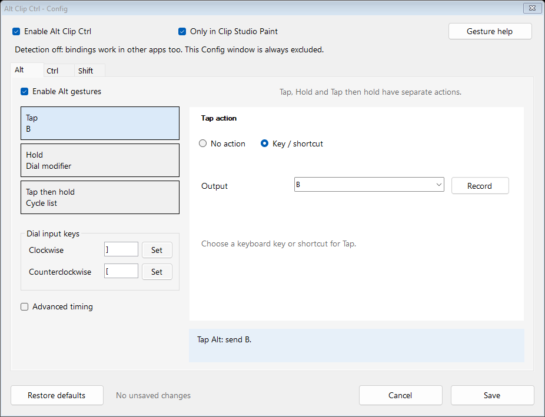

# Alt Clip Ctrl · legacy Windows helper

A standalone Windows helper for Clip Studio Paint with configurable modifier gestures, dial shortcuts, scrolling, and independent tool cycles. No AutoHotkey or installer is required.

## Start

Download the Windows ZIP from [Releases](https://github.com/SimplePhilipp/Alt-Clip-Ctrl/releases/tag/v1.4.1), extract it to a writable folder, and run AltClipCtrl.exe. Exit the previous version first. Keep AltClipCtrl.settings.xml beside the new executable to preserve saved settings. Closing the main window exits the app; minimizing keeps it running.

## Config

Choose the Alt, Ctrl, or Shift tab, then select Tap, Hold, or Tap then hold on the left. Only relevant controls appear on the right.

- **Tap:** press and release. Choose No action or Key / shortcut. Scrolling is no longer offered for Tap.
- **Hold:** press and keep holding.
- **Tap then hold:** tap, release, then press and keep holding again.

Hold and Tap then hold offer exactly the same five choices:

| Action | Behavior |
| --- | --- |
| No action | Sends nothing for that gesture, including dial turns. |
| Dial modifier | Holds that tab's native modifier between turns; clockwise and counterclockwise inputs send the configured outputs. |
| Cycle list | Moves through that modifier's editable list. |
| Dial scrolling | Sends mouse-wheel input, with direction reversal and 1-20 notches per step. |
| Hold a key | Holds the selected key or chord until release. |

Dial modifier is the renamed Original modifier action. Older settings migrate automatically. Old Tap scroll assignments become No action; other settings are retained. The previously removed No modifier profile stays removed.

The three gestures have independent action choices. Each modifier has its own cycle list and position; its dial output pair and scroll controls are shared by gestures using those actions. You can configure disabled profiles without enabling them.

**Advanced timing** is collapsed by default. The tap/second-press window defaults to 100 ms. Maximum short press defaults to 300 ms. A custom Hold a key action starts after Maximum short press for Hold, or on the second press for Tap then hold. Dial turns act immediately.

The input keys are configured on the left. **Set** records an input key; **Record** records an output shortcut. The cycle editor supports adding, removing, and reordering entries. The sentence preview describes the selected action. Unsaved changes remain pending while you switch tabs or gestures. Save applies and persists them; Cancel discards them. Restore defaults only applies after Save.

## Dial setup and scrolling

The controller button should send the selected modifier down when pressed and up when released. Turns should send the corresponding modifier plus the configured input key (default ] clockwise and [ counterclockwise). Use the controller button that is actually assigned to that modifier.

Software-generated input is accepted. The helper ignores only its own marked output. Repeated modifier-down/bracket/modifier-up packets from controller software retain the held gesture.

Scrolling acts at the mouse pointer according to the target app's normal mouse-wheel handling. Hover over a scrollable panel or slider before turning. This does not automatically locate a color wheel or make unsupported controls scrollable. The first packet in a scroll gesture releases the activation modifier before the wheel event, avoiding Ctrl+wheel zoom or Shift+wheel horizontal scrolling. Subsequent turns send only wheel events, without repeated modifier keystrokes.

Scroll up/down remain available as clockwise/counterclockwise outputs under Dial modifier. Direct scroll outputs send one notch; Dial scrolling uses its amount and reversal settings. Inputs remain keyboard keys. Key and shortcut text supports B, F12, Space, Ctrl+Shift+F1, Plus, Minus, and similar key names. Pure modifiers such as Ctrl or Alt can be used for Hold a key.

## Scope and tracking

The global enable switch and **Only in Clip Studio Paint** switch stay at the top. Turning detection off permits bindings in other foreground apps. The helper's own windows are excluded. Pause in the tray temporarily disables the helper.

Default cycle order:

| Shortcut | Tool | Shortcut | Tool |
| --- | --- | --- | --- |
| 1 | Pen | F2 | Auto select |
| 2 | Sketch | F3 | Gradient |
| 3 | Blend | F4 | Operation |
| 4 | Brush | F5 | Figure |
| 5 | Eraser | F6 | Text |
| 6 | Airbrush | F7 | Comic |
| 7 | Liquify | F8 | Ruler |
| 8 | Decoration | F9 | Correct line |
| 9 | Selection area | F10 | Move |
| F1 | Fill | F11 | Eyedropper |

Set matching shortcuts in CSP yourself and remove collisions with other CSP commands. Each list supports 1-64 unique entries. Lists wrap independently. A direct keyboard shortcut updates matching entries in all lists; generated outputs update only their originating profile.

CSP does not expose its current tool through a supported simple query. After selecting a tool with the mouse, press its configured shortcut to resync. The helper remembers requested selections and cannot confirm CSP accepted them. Unknown tap outputs reset that profile's tracker. No action and scrolling retain its position. The tray can forget all cycle positions.

Use shortcut actions with the canvas active, outside dialogs and text editing, and between brush strokes.

## Efficiency and privacy

The fast gesture timer sleeps when no gesture deadline or queued interface refresh needs processing. Scrolling reuses prepared native input packets and dispatches directly from validated dial input, without waiting for the UI message queue. It does not batch, net together opposite directions, or add a smoothing timer. Tool shortcut lookup uses cached indexes. Foreground process checks are cached; focus events handle app changes with a one-second fallback. UI refreshes are coalesced about 40 ms apart. No artificial delay is added to dial steps.

No network code, clipboard access, keystroke history, startup entry, registry changes, or automatic updater is included. Only settings saved through Config are persisted. Temporary input listeners are removed outside the selected scope or when paused/disabled. Held outputs are released on gesture release, focus change, applying settings, pause, disable, or exit.

The executable is unsigned. Keep CSP and the helper at normal privileges; Windows may block input sent to a more privileged app.

## Source and validation

The public source is [SimplePhilipp/Alt-Clip-Ctrl](https://github.com/SimplePhilipp/Alt-Clip-Ctrl). Build with build.ps1 using Microsoft's existing .NET Framework compiler. The executable is written to bin/AltClipCtrl.exe.

Run test.ps1 for gesture/output/config tests, or test.ps1 -Smoke for UI and cleanup checks. Diagnostic tests emit no real keyboard or scroll input. Coverage includes all gesture modes, identical hold choices, tap scrolling exclusion, idle timer demand, 60,000 scroll-session turns with rapid reversals, 12,000 immediate-dispatch/overlapping-notch checks, 3,000 wrapped ordinary turns, modifier-free wheel packets, session release/focus reset, independent cycles, migration, and held-output cleanup. UI previews were visually checked. No hardware latency or CPU percentage is claimed.

## Config preview

